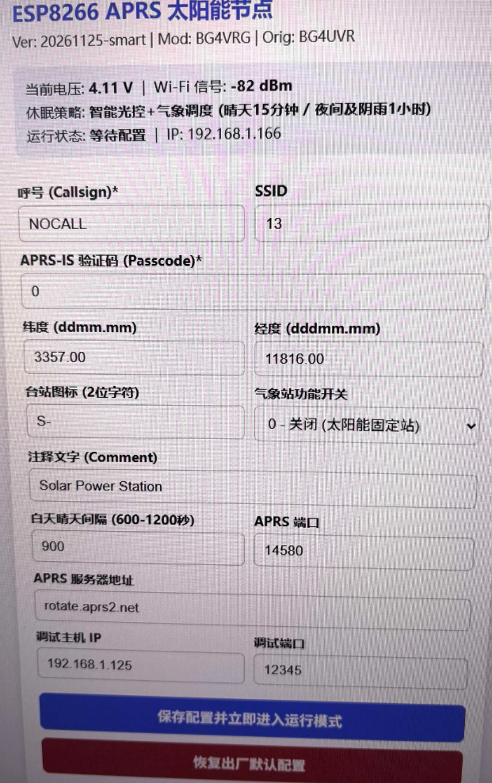
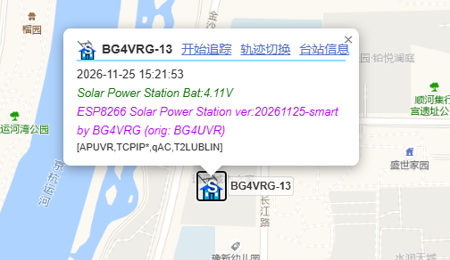

# Esp8266MWS -> 太阳能低功耗 APRS 固定台 (v2.1)

- **原作者**：BG4UVR (基于 v0.17a)
- **修改者**：BG4VRG @ 2026.11.28
- **项目地址**：https://github.com/bg4vrg/esp8266mws

---

## 一、 项目简介与新版特性

本项目基于 `bg4uvr/esp8266mws` (v0.17a) 深度重构。为符合国内无线电管理规范并兼顾环境监测需求，新版固件默认关闭标准 CWOP 气象报文协议，将其改造为一款支持**注释附带环境参数、昼夜与阴雨天智能休眠、内置网页配置后台、支持 aprs.fi 遥测曲线**的太阳能低功耗 APRS 固定台（默认图标 `S-`，SSID `-13`）。

* **位置报文（绿字）示例**：`ESP Solar Sta. Bat:3.99V 21.5C 45% 1013hPa`
* **状态报文（紫字）**：`太阳能低功耗APRS固定台 v2.1 by BG4VRG (Orig: BG4UVR)`

### 核心新增功能

1. **三档传感器工作模式（网页下拉切换 / `-t 0/1/2`）**：
   * **`0` - 纯固定站模式**：不初始化也不读取传感器，仅发送位置与供电电压（`Bat:x.xxV`），适合未接传感器或极致省电场景。
   * **`1` - 固定站 + 注释附带温湿度气压（默认推荐）**：保持太阳能房屋图标（`S-`），不触发标准气象协议，将温度、湿度、气压作为纯文本追加在电压之后。
   * **`2` - 标准 APRS 气象站模式**：自动切换为 `R_` 气象站图标并发送标准 `.../...g...t...` 气象报文（留作大陆以外地区备用）。
2. **高精度传感器优选与异常值过滤**：
   * **温度数据源策略**：优先采纳专职温湿度芯片 **AHT20** 的测温数据（典型精度 ±0.3°C），避免气压计热传导带来的温漂；仅当 AHT20 未连接或读数异常时自动回退使用 **BMP280** 温度(典型精度±1.0°C)。
   * **物理范围校验**：内置合理区间过滤（温度-40°C ~ 85°C、湿度 0%~100%、气压 300~1100hPa），防止单颗传感器偶发通信异常（如 `-146°C`）污染对外播发的报文；网页后台顶部状态栏同步展示两路原始传感器读数方便核对。
3. **三层自适应太阳能休眠调度**：
   * **白天晴好模式（WMO 天气代码 `0~2`）**：按设定间隔（默认 **15 分钟**，600–1200 秒可调）发送位置与遥测，发完立即进入深度休眠（`deepSleep`）。
   * **夜间天文休眠模式**：无需额外接口，芯片本地根据配置经纬度与 NTP 时间实时计算当日日出/日落时刻。日落至次日日出时段自动切换为 **1 小时（3600 秒）** 深度休眠一次（注释自动附加 `[Night]`）。
   * **白天阴雨节能模式**：白天唤醒时请求 Open-Meteo 免费气象接口（免注册/免 Key），当当地天气代码 $\ge 3$（阴天、雾、雨、雪）时，即便满电也会提前切换为 **1 小时（3600 秒）** 深度休眠一次（注释自动附加 `[Cloudy]`）。
   * **两级低电压保护**：芯片供电电压 < 3.15V时自动切为 1 小时低功耗模式（附加 `[LowPower]`）；电压 < 3.00V 时不开 Wi-Fi 射频直接休眠 1 小时保护电池。
4. **内置网页配置后台（80 端口）与一键唤醒**：
   * 处于配置模式时，手机或电脑浏览器直接访问 **`http://设备IP`** 即可可视化修改所有参数，并实时查看供电电压、Wi-Fi 信号与传感器状态。
   * **快捷进入配置模式**：正常运行时，按一下 `RST` 重启（或重新上电）的同时**按住板载 `FLASH` 键（GPIO0）约 2\~3 秒**，待蓝色指示灯常亮不灭即可随时通过浏览器打开配置后台。
5. **aprs.fi 标准遥测曲线（`T#` 协议）**：
   * 利用芯片内部 RTC 内存跨休眠保存遥测序号，首次开机及每隔 3 小时自动发送 `PARM` / `UNIT` / `EQNS` 定义包，在 `aprs.fi` 自动绘制**供电电压（V）**、**Wi-Fi 信号强度（dBm）**、**唤醒计数**历史曲线，并显示工作模式、低电、夜间、阴雨状态指示位。
---
## 二、 硬件接线说明

1. **深度休眠定时唤醒（必接）**：
   - 将开发板的 **`D0 (GPIO16)` 引脚与 `RST` 引脚**通过一颗 **470Ω 电阻**（或 1N5819 肖特基二极管，负极朝向 D0）短接。
   - **注意**：通过 USB 数据线烧录固件时**必须先断开此跳线**，烧录完成后再接回（无线 OTA 升级无需断开）。
2. **太阳能供电接线**：
   - 5V/6V 太阳能板 ➔ 锂电池太阳能充电管理板cn3791 -**18650锂电池充电保护模块**➔ 3.7V 18650 锂电池；充电板输出接开发板 `5V/VIN` 与 `GND`（若充电板带 3.3V 低静态电流稳压输出，可直接接 `3V3` 与 `GND`）。
   - 3.7V 18650 锂电池充满电时端电压为 **4.20V**，而 ESP8266 芯片 `3V / 3V3` 引脚直接连通芯片内核（额定 3.3V，极限耐压 **3.6V**），且绕过了开发板自带的 AMS1117 稳压芯片。**切勿将电池保护板 `P+` 直接连入开发板 `3V` 引脚**，否则长期超压易损坏芯片。
   - **推荐供电接法（任选其一）**：
     1. **超低压差 LDO 稳压（最推荐）**：保护板 `P+` ➔ 外接 **HT7333** 或 **ME6211-3.3V** 稳压模块 ➔ 开发板 **`3V`** 引脚（压差仅 0.09V，静态电流低至数微安，可充分释放锂电池容量）。
     2. **串联二极管降压（零成本应急）**：在保护板 `P+` 与开发板 `3V` 引脚之间正向串联一颗 **`1N4007` 二极管**（白环朝向开发板 `3V`），利用约 0.65V 正向压降将满电 4.2V 降至 3.55V 安全区间。
     3. **磷酸铁锂电池直连**：改用标称 3.2V 的磷酸铁锂电池及专用 3.65V 充电板，满电 3.6V 可直接接开发板 `3V` 引脚。
3. **气温湿度气压传感器接线（可选，默认气象站功能关闭）**：
   
   * 将 **AHT20 + BMP280** 二合一模块的 `SDA` 接 **`GPIO12 (D6)`**，`SCL` 接 **`GPIO14 (D5)`**，`VCC` 接 `3V`，`GND` 接 `GND`。
   
   
   
   

---

## 三、 配网与参数配置说明

### 1. Wi-Fi 配网

- 首次上电或更换路由器后，手机搜索 2.4GHz Wi-Fi 热点 **`Esp8266MWS-SET`**（无密码）并连接，在弹出的配网页面（或访问 `192.168.4.1`）中选择家庭 Wi-Fi 并保存。

### 2. 网页后台配置（推荐）

- 首次烧录或恢复出厂设置后，设备连上路由器会保持蓝灯常亮（等待配置状态）。

- 在路由器后台查看设备局域网 IP，浏览器打开 **`http://设备IP`**，填写呼号、APRS 验证码、度分格式经纬度（`ddmm.mm` / `dddmm.mm`）后点击保存即可自动重启运行。

  

### 3. TCP 调试主机命令行配置（兼容原版方式）

设备运行或处于配置模式时，会尝试连接设定的调试主机 IP 与端口（默认 `192.168.1.125:12345`），支持发送以下命令（均需以换行符 `\n` 结尾）：

| 命令 / 参数 | 含义                | 示例 / 格式说明                                              |
| :---------- | :------------------ | :----------------------------------------------------------- |
| `cfg ...`   | 配置参数            | `cfg -c BG4VRG -w 12345 -a 3456.77 -o 11888.88`              |
| `-c`        | 呼号（必设）        | 4~6 位个人台站呼号，如 `BG4VRG`                              |
| `-w`        | APRS 验证码（必设） | 对应呼号的 5 位数字验证码                                    |
| `-a` / `-o` | 纬度 / 经度         | 度分格式：`ddmm.mm`（北正南负）/ `dddmm.mm`（东正西负）      |
| `-d`        | SSID                | 默认 `13`（支持 1~2 位数字或字母）                           |
| `-t`        | 气象功能开关        | `0` 关闭（默认，自动设图标 `S-`）；`1` 开启（自动设图标 `R_`） |
| `-i`        | 台站图标            | 2 位 APRS 符号代码，如 `S-`（太阳能房屋）、`/-`（家庭）、`/>`（汽车） |
| `-m`        | 注释文字            | 最长 38 字节，含空格请加英文双引号，如 `-m "Solar Station"`  |
| `-n`        | 晴天发送间隔        | 单位：秒，范围 `600` ~ `1200`（默认 `900`）                  |
| `-s` / `-p` | APRS 服务器/端口    | 默认 `rotate.aprs2.net` / `14580`                            |
| `-g` / `-e` | 调试主机 IP/端口    | 默认 `192.168.1.125` / `12345`                               |
| `-l`        | 提示语言            | `0` 中文（默认）；`1` 英文                                   |
| `rst`       | 重启设备            | 发送 `rst\n` 立即软重启                                      |
| `def`       | 恢复出厂设置        | 发送 `def\n` 清空 EEPROM 配置、恢复默认值并重启              |

---

## 四、 代码编译与固件烧写

本部分仍然可以参照bg4uvr的文档烧录，没有变化

https://github.com/bg4uvr/esp8266mws

### 1. Arduino IDE 环境准备与编译

1. 安装 **Arduino IDE**（1.8.x 或 2.3.x 均可）。

2. 打开 **文件 -> 首选项**，在「其他开发板管理器地址」中添加 ESP8266 开发板源（国内推荐使用加速镜像）：

   ```text
   https://arduino.me/packages/esp8266.json
   ```

3. 打开 **工具 -> 开发板 -> 开发板管理器**，搜索 `esp8266` 并安装（推荐 **`3.1.2`** 或 `3.0.2` 版本）。

4. 打开 **项目 -> 加载库 -> 管理库**，搜索并安装以下依赖库（关联依赖一并安装）：

   - `WiFiManager` (by tzapu)
   - `Adafruit_BMP280_Library` (by Adafruit)
   - `Adafruit_AHTX0` (by Adafruit)

5. 在 **工具 -> 开发板** 中选择对应的 ESP8266 型号（如 `NodeMCU 1.0 (ESP-12E Module)` 或 `LOLIN(WEMOS) D1 R2 & mini`），选择正确的 COM 端口。

   [ch340/341驱动下载](ch340/341驱动下载)

6. 断开 `D0-RST` 唤醒跳线后，ide打开项目源码esp8266mws.ino，点击左上角 **上传 (→)** 直接烧录，或点击 **项目 -> 导出已编译的二进制文件** 生成 `.ino.bin` 固件。

### 2. 使用 Flash Download Tool 直接烧写 `.bin` 固件

1. 从本仓库firmware文件夹内下载编译好的 `.bin` 固件文件。

2. 打开乐鑫官方烧录工具 **[Flash Download Tool](https://www.espressif.com/sites/default/files/tools/flash_download_tool_v3.8.8_0.zip)**，芯片类型选择 **`ESP8266`**。

3. 固件路径选择下载的 `.bin` 文件，烧录地址填写 **`0x00000`** 并勾选左侧复选框。

4. SPI SPEED 选择 `40MHz`，SPI MODE 选择 `DIO`（部分模块可选 `DOUT`），选择开发板对应的 `COM` 口，波特率选择 `115200` 或 `460800`。

5. 确认已断开 `D0-RST` 跳线，点击 **`START`** 开始烧写，进度条走完显示 `FINISH` 后接回唤醒跳线并按 `RST` 键重启即可

### 3. 无线 OTA 局域网升级

   1. 保持 `D0-RST` 跳线连接，正常运行时，按一下 `RST` 重启（或重新上电）的同时**按住板载 `FLASH` 键约 2\~3 秒**，待蓝色指示灯常亮不灭即可随时通过浏览器打开配置后台。(注意，这里我不确定怎么折腾的成功了，请大家自行尝试)
   2. 确保电脑与开发板处于同一局域网并放行 Windows 防火墙中的 `python.exe` 网络访问。
   3. 在 Arduino IDE **工具 -> 端口** 中选择网络端口 **`Esp8266MWS-OTA at 192.168.x.x`**，点击上传（默认密码留空直接回车）即可在 15 秒内完成无线更新。


## 五、改进

   1、杜邦线还是不牢靠，长期稳定运行依然推荐使用焊接

​	测试过程中出现接触不良导致的无法供电

2、默认图标显示的是天线+房子，并不是太阳能板+房子，这是因为aprs.fi只支持标准图标



​	具体图标参照这里的没问题，到底还是网站支持问题https://www.aprs.org/symbols.html


3、目前我还是4.2v电池直接怼到8266的3v输入，极有可能烧坏板子，先这样吧后期有时间在

