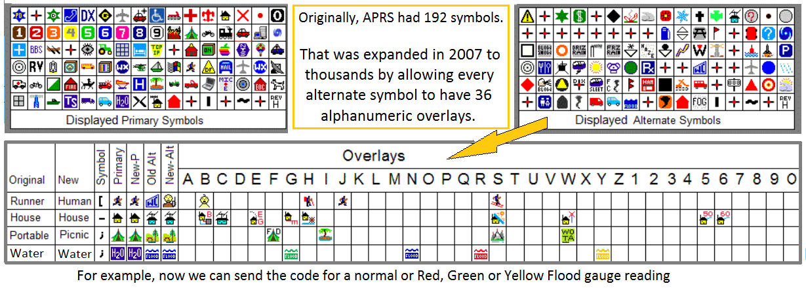

# Esp8266MWS -> APRS太阳能固定站(Ver: 20261125-smart)

- **原作者**：BG4UVR (基于 v0.17a)
- **修改者**：BG4VRG
- **项目地址**：https://github.com/bg4vrg/esp8266mws

---

## 一、 项目简介与新版特性

本项目基于 `bg4uvr/esp8266mws` (v0.17a) 改造。为符合国内无线电管理规范，新版固件**默认关闭气象数据上传**，将其改造为一款支持**昼夜与阴雨天智能休眠、内置网页配置后台、支持 aprs.fi 遥测曲线**的超低功耗太阳能 APRS 固定台站（默认图标 `S-`，SSID `-13`）。

### 核心新增功能

1. **三层智能休眠调度（延长阴雨天续航）**：
   - **白天晴好模式（WMO 天气代码 `0~2`）**：按设定间隔（默认 **15 分钟**，600–1200 秒可调）发送位置与遥测，发完立即进入深度休眠（`deepSleep`）。
   - **夜间天文休眠模式**：无需额外接口，芯片本地根据配置经纬度与 NTP 时间实时计算当日日出/日落时刻。处于日落至次日日出时段自动切换为 **1 小时（3600 秒）** 深度休眠一次（报文注释自动附加 `[Night]`）。
   - **白天阴雨节能模式**：白天唤醒时顺带查询 Open-Meteo 免费气象接口（免注册/免 Key），当当地天气代码 `≥ 3`（阴天、雾、雨、雪）时，即便电池满电也会提前切换为 **1 小时（3600 秒）** 深度休眠一次（注释自动附加 `[Cloudy]`）。
   - **两级低电压保护**：芯片供电电压 `< 3.15V` 时自动进入 1 小时低功耗模式（附加 `[LowPower]`）；电压 `< 3.00V` 时不开 Wi-Fi 射频直接休眠 1 小时保护电池。
   
2. **内置网页配置后台**：
   - 无需依赖电脑 TCP 调试软件，处于配置模式时，手机或电脑浏览器直接访问 **`http://设备IP`** 即可可视化修改呼号、验证码、经纬度、图标、注释文字与气象开关。
   - **快捷进入配置模式**：正常运行时，按一下 `RST` 重启（或重新上电）的同时**按住板载 `FLASH` 键（GPIO0）约 2~3 秒**，待蓝灯常亮不灭即可随时通过浏览器打开配置后台。
   
3. **aprs.fi 标准遥测曲线（`T#` 协议）**：
   - 利用芯片内部 RTC 内存跨休眠保存遥测序号，定时发送 `PARM` / `UNIT` / `EQNS` 定义包，在 `aprs.fi` 台站页面自动生成**供电电压（V）**、**Wi-Fi 信号强度（dBm）**历史折线图，并显示气象开关、低电、夜间、阴雨状态指示位。
   
4. **气象功能动态开关与自定义扩展**：
   - 保留原版 BMP280 / AHT20 驱动代码，可通过网页或命令 `cfg -t 1` / `cfg -t 0` 随时手动启停气象站功能（自动联动 `R_` 与 `S-` 图标）。
   
   - 支持 `-i` 自定义 APRS 图标、`-m` 自定义带空格注释文字（默认 `"Solar Station"`）以及 `def` 指令一键恢复出厂默认配置。
   
     

---

## 二、 硬件接线说明

1. **深度休眠定时唤醒（必接）**：
   - 将开发板的 **`D0 (GPIO16)` 引脚与 `RST` 引脚**通过一颗 **470Ω 电阻**（或 1N5819 肖特基二极管，负极朝向 D0）短接。
   - **注意**：通过 USB 数据线烧录固件时**必须先断开此跳线**，烧录完成后再接回。
2. **太阳能供电接线**：
   - 5V/6V 太阳能板 ➔ 锂电池太阳能充电管理板cn3791 -**18650锂电池充电保护模块**➔ 3.7V 18650 锂电池；充电板输出接开发板 `5V/VIN` 与 `GND`（若充电板带 3.3V 低静态电流稳压输出，可直接接 `3V3` 与 `GND`）。
3. **气象传感器接线（可选，默认关闭）**：
   - 如需临时开启气象调试，将 AHT20 + BMP280 模块的 `SDA` 接 **`GPIO12 (D6)`**，`SCL` 接 **`GPIO14 (D5)`**。

---

## 三、 配网与参数配置说明

### 1. Wi-Fi 配网

- 首次上电或更换路由器后，手机搜索 2.4GHz Wi-Fi 热点 **`Esp8266MWS-SET`**（无密码）并连接，在弹出的配网页面（或访问 `192.168.4.1`）中选择家庭 Wi-Fi 并保存。

### 2. 网页后台配置（推荐）

- 首次烧录或恢复出厂设置后，设备连上路由器会保持蓝灯常亮（等待配置状态）。

- 在路由器后台查看设备局域网 IP，浏览器打开 **`http://设备IP`**，填写呼号、APRS 验证码、度分格式经纬度（`ddmm.mm` / `dddmm.mm`）后点击保存即可自动重启运行。

  

### 3. TCP 调试主机命令行配置（兼容原版方式）

设备运行或处于配置模式时，会尝试连接设定的调试主机 IP 与端口（默认 `192.168.1.125:12345`），支持发送以下命令（均需以换行符 `\n` 结尾）：

| 命令 / 参数 | 含义                | 示例 / 格式说明                                              |
| :---------- | :------------------ | :----------------------------------------------------------- |
| `cfg ...`   | 配置参数            | `cfg -c BG4VRG -w 12345 -a 3456.77 -o 11888.88`              |
| `-c`        | 呼号（必设）        | 4~6 位个人台站呼号，如 `BG4VRG`                              |
| `-w`        | APRS 验证码（必设） | 对应呼号的 5 位数字验证码                                    |
| `-a` / `-o` | 纬度 / 经度         | 度分格式：`ddmm.mm`（北正南负）/ `dddmm.mm`（东正西负）      |
| `-d`        | SSID                | 默认 `13`（支持 1~2 位数字或字母）                           |
| `-t`        | 气象功能开关        | `0` 关闭（默认，自动设图标 `S-`）；`1` 开启（自动设图标 `R_`） |
| `-i`        | 台站图标            | 2 位 APRS 符号代码，如 `S-`（太阳能房屋）、`/-`（家庭）、`/>`（汽车） |
| `-m`        | 注释文字            | 最长 38 字节，含空格请加英文双引号，如 `-m "Solar Station"`  |
| `-n`        | 晴天发送间隔        | 单位：秒，范围 `600` ~ `1200`（默认 `900`）                  |
| `-s` / `-p` | APRS 服务器/端口    | 默认 `rotate.aprs2.net` / `14580`                            |
| `-g` / `-e` | 调试主机 IP/端口    | 默认 `192.168.1.125` / `12345`                               |
| `-l`        | 提示语言            | `0` 中文（默认）；`1` 英文                                   |
| `rst`       | 重启设备            | 发送 `rst\n` 立即软重启                                      |
| `def`       | 恢复出厂设置        | 发送 `def\n` 清空 EEPROM 配置、恢复默认值并重启              |

---

## 四、 代码编译与固件烧写

本部分仍然可以参照bg4uvr的文档烧录，没有变化

https://github.com/bg4uvr/esp8266mws

### 1. Arduino IDE 环境准备与编译

1. 安装 **Arduino IDE**（1.8.x 或 2.3.x 均可）。

2. 打开 **文件 -> 首选项**，在「其他开发板管理器地址」中添加 ESP8266 开发板源（国内推荐使用加速镜像）：

   ```text
   https://arduino.me/packages/esp8266.json
   ```

3. 打开 **工具 -> 开发板 -> 开发板管理器**，搜索 `esp8266` 并安装（推荐 **`3.1.2`** 或 `3.0.2` 版本）。

4. 打开 **项目 -> 加载库 -> 管理库**，搜索并安装以下依赖库（关联依赖一并安装）：

   - `WiFiManager` (by tzapu)
   - `Adafruit_BMP280_Library` (by Adafruit)
   - `Adafruit_AHTX0` (by Adafruit)

5. 在 **工具 -> 开发板** 中选择对应的 ESP8266 型号（如 `NodeMCU 1.0 (ESP-12E Module)` 或 `LOLIN(WEMOS) D1 R2 & mini`），选择正确的 COM 端口。

   [ch340/341驱动下载](ch340/341驱动下载)

6. 断开 `D0-RST` 唤醒跳线后，ide打开项目源码esp8266mws.ino，点击左上角 **上传 (→)** 直接烧录，或点击 **项目 -> 导出已编译的二进制文件** 生成 `.ino.bin` 固件。

### 2. 使用 Flash Download Tool 直接烧写 `.bin` 固件

1. 从本仓库firmware文件夹内下载编译好的 `.bin` 固件文件。

2. 打开乐鑫官方烧录工具 **[Flash Download Tool](https://www.espressif.com/sites/default/files/tools/flash_download_tool_v3.8.8_0.zip)**，芯片类型选择 **`ESP8266`**。

3. 固件路径选择下载的 `.bin` 文件，烧录地址填写 **`0x00000`** 并勾选左侧复选框。

4. SPI SPEED 选择 `40MHz`，SPI MODE 选择 `DIO`（部分模块可选 `DOUT`），选择开发板对应的 `COM` 口，波特率选择 `115200` 或 `460800`。

5. 确认已断开 `D0-RST` 跳线，点击 **`START`** 开始烧写，进度条走完显示 `FINISH` 后接回唤醒跳线并按 `RST` 键重启即可。


## 五、改进

   1、杜邦线还是不牢靠，长期稳定运行依然推荐使用焊接

​	测试过程中出现接触不良导致的无法供电

2、默认图标显示的是天线+房子，并不是太阳能板+房子，这是因为aprs.fi只支持标准图标


​	具体图标参照这里的没问题，到底还是网站支持问题https://www.aprs.org/symbols.html



3、目前是4.2v电池直接怼到8266的3v输入，极有可能烧坏板子

目前有2个思路：方案 1：加一颗超低压差 LDO（HT7333 ）

- **接线方法**：保护板 `P+` ➔ 接 **HT7333-A**的输入脚 ➔ 输出脚接开发板的 **`3V`** 引脚（三者共地，输入输出各并一颗 10µF 电容）。
- **优势**：HT7333 自身压差仅 **0.09V（90mV）**，静态功耗仅 **4µA**。电池从 `4.2V` 一直用到 `3.4V`，输出端都能稳稳输出 `3.30V`，把 18650 电池 90% 以上的电量榨干，且芯片绝对安全。

#### 方案 2：串接一颗普通硅二极管临时降压 —— 零成本应急方案

- **接线方法**：在保护板 `P+` 和开发板 `3V` 引脚之间，正向串联一颗常见的 **`1N4007` 二极管**（有白环的一端朝向开发板 `3V`）。
- **原理**：硅二极管正向导通有约 **0.6V ~ 0.7V** 的固定压降。满电 `4.2V` 经过二极管后变成约 **`3.55V`**（在 ESP8266 的 3.6V 安全范围内）；当电池用到 `3.7V` 时，经过二极管变成 `3.05V`，刚好触发我们代码里设定的 `3.00V` 欠压保护休眠，安全可靠。